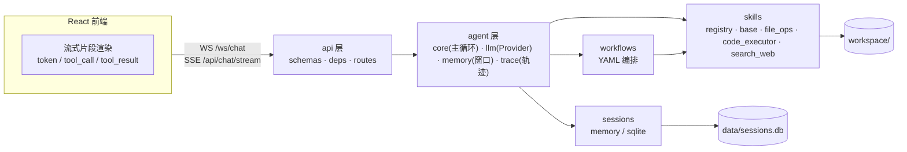

# AI Agent · 可插拔的多模型 Agent 框架


> 一个**能真正跑起来**的 Agent 框架：token 级流式、工具调用、YAML 工作流、会话持久化，
> 以及一套不把「执行代码 / 读写文件 / 改配置」当儿戏的安全边界。
> 零密钥即可启动（内置 Mock Provider），clone 下来两条命令就能看到效果。

```bash
pip install -r requirements.txt && python main.py   # 没填 API Key 也能启动，自动进入 Mock 模式
# 打开 http://localhost:8000  →  输入「用 Python 写一个冒泡排序，然后执行它」
```

---

## 这个项目解决什么问题

Agent 的门槛不在「调一次 chat completion」，而在调通之后的一堆工程问题：

- 模型输出的工具参数是 JSON 字符串、还是分片到达的增量，怎么稳定拼装？
- 一次回答里有多工具并行、超时、返回 `ERROR[...]` 时，怎么让模型自己纠错而不是整个请求 500？
- 长对话按「条数」截断会切断 `assistant(tool_calls)` 与 `tool` 的配对，接口直接 400 —— 怎么按「轮」和 token 预算裁剪？
- 「执行 Python 代码」「读写文件」这类能力，边界应该画在哪里才敢放进一个 Web 服务？
- 重启之后会话全没了、线上出问题无法复盘某一步耗时和失败原因，怎么办？

这个仓库把上面每条都做成了可验证的实现 + 回归测试，而不是 README 里的一句承诺。

## 一眼看懂的能力

| 能力 | 实现要点 | 验证方式 |
|---|---|---|
| **token 级流式** | LLM 层把 SSE 增量解析成 `Delta`；主循环边收边 `emit("token")`；前端按片段拼装（文本/工具混排） | `POST /api/chat/stream` 断言 `token` 事件 ≥ 1；WS 客户端断言事件序列 |
| **工具调用** | 技能自声明 JSON Schema → 自动转 function calling；参数校验、enum/range、未知参数丢弃 | `tests/test_registry.py`、`test_file_ops.py` |
| **并行 + 超时 + 纠错** | `asyncio.gather` 并行执行、单工具 `wait_for`、失败回喂 `ERROR[code]` | `tests/test_agent.py` |
| **记忆窗口** | 只在 user 轮边界切窗 + token 预算裁剪，保留 tool 配对；超阈值触发摘要 | `tests/test_memory.py` |
| **会话持久化** | `SessionStore` 协议：内存 LRU+TTL / SQLite upsert + 淘汰 + 坏数据自愈 | `tests/test_session_store.py` |
| **YAML 工作流** | 模板变量可嵌字符串、缺失变量报 `missing_variable`、失败返回已完成步骤 | `tests/test_workflow.py`（含端到端写盘断言） |
| **可观测** | 每次 LLM/工具调用记 `TraceStep`（耗时/状态/token），随 `answer` 事件返回 | 前端消息尾部显示 `65ms · 1 次工具` |
| **零密钥可跑** | Mock Provider 覆盖「工具调用 → 结果 → 流式回答」全链路，结果确定 | `MOCK_LLM=true` 下 e2e 冒烟 |

## 架构



一次请求的事件时序（前端只需理解这一条链路）：

```text
thinking → token* → tool_call → tool_result → token* → answer(trace)
```

细节见 **[docs/ARCHITECTURE.md](docs/ARCHITECTURE.md)** 与 **[docs/TOOL_PROTOCOL.md](docs/TOOL_PROTOCOL.md)**（事件信封、技能声明、错误码表、HTTP 契约）。

## v2 → v3：这次重构改了什么

不是加功能，是**把「能演示」变成「能交付」**。下表只列可验证的缺陷与修复：

| # | v2 的实际情况 | 后果 | v3 的处理 |
|---|---|---|---|
| 1 | 记忆按条数硬切 `messages[-max_turns*2:]` | 切断 `assistant(tool_calls)`↔`tool` 配对 → 长对话必 400 | 按 user 轮边界切窗 + token 预算，整组丢弃 |
| 2 | 路径越界用 `str(target).startswith(str(BASE))` | `workspace2/` 等同前缀兄弟目录可越权读写 | `os.path.commonpath` 目录级判断 + `path_escape` |
| 3 | 代码执行靠字符串黑名单 `'os.system' in code`，且 `exec` 跑在宿主进程里、替换全局 `sys.stdout` | `__import__('os')` 一行绕过；并发请求输出串流 | AST 白名单 + 危险调用拦截 + `python -I` 子进程 + 独立临时目录 + 超时 kill |
| 4 | `POST /api/config` 无鉴权，可改 `base_url`；CORS `*` + `credentials=True` | 任何人能把你的 API Key 引到他自己的服务器；浏览器直接拒收 | 默认 403（需 `ALLOW_RUNTIME_CONFIG` + `ADMIN_TOKEN`，`compare_digest` 比较）；CORS 白名单 |
| 5 | README 写「打字机效果」，实际只在结尾推一次整段 `answer` | 文档与实现不符 | 真 token 增量：`Delta` → `token` 事件，前端流式拼装 |
| 6 | 单例 Agent + 覆盖 `on_stream` 回调 | 两个标签页同时对话互相抢回调 | 回调按调用传入 `run(..., on_event=cb)` |
| 7 | 会话存进程内 dict，无上限无过期 | 重启即丢；长跑必涨内存 | `SessionStore` + SQLite upsert + LRU/TTL 淘汰 |
| 8 | 无测试、无 lint、无类型检查、无 CI | 改动靠手点，回归靠运气 | 92 个测试 / ruff / mypy / GitHub Actions |
| 9 | `WorkflowEngine(skill_registry or registry)` | 空 registry 因 `__len__==0` 被当假值，静默用全局注册表 | 改 `is not None`（这个 bug 就是被 `test_missing_skill_is_structured` 抓出来的） |

## 安全边界（可复现）

| 面 | 约束 | 关键代码 |
|---|---|---|
| 文件 | 只能读写 `WORKSPACE_DIR` 内；读/写各有字符与字节上限 | `skills/file_ops.py` |
| 代码 | 仅标准库白名单 + 禁 `eval/exec/compile/__import__/getattr-dunder`；子进程、临时 cwd、超时即杀 | `skills/code_executor.py` |
| 配置 | 运行期改配置默认关闭；开启后仍需管理员令牌 | `api/deps.py`、`config.py` |
| 请求 | 超 `MAX_REQUEST_BYTES` 直接 413；统一错误体 `{error_code,message}` | `main.py` |
| 密钥 | `GET /api/config` 只回 `has_api_key`，绝不回显 Key | `config.public_dict()` |

## 快速开始

### 方式一：本地（零密钥先看效果）

```bash
pip install -r requirements.txt
cp .env.example .env       # 可以不填任何 Key
python main.py             # 单端口同时托管前端（需先构建前端）
```

前端两种用法：

```bash
cd frontend && npm ci
npm run dev                       # 开发模式 :5173，通过 vite 代理转发 /api、/ws
npm run build                     # 生产构建 → frontend/dist，由后端 :8000 托管
```

演示用打字机效果（Mock 模式每 chunk 间隔）：

```bash
MOCK_LLM=true MOCK_LATENCY=0.03 python main.py
```

### 方式二：Docker

```bash
cp .env.example .env      # 可选，填真实 Key
docker compose up --build # http://localhost:8000
```

> 镜像为两阶段构建（node 编前端 → python 跑后端），以非 root 用户运行，自带 `HEALTHCHECK`。
> 本机未安装 Docker，镜像构建由 CI 的 `docker` job 首次验证；`docker-compose.yml` 已按同构方式编写。

### 接入真实模型

任何 OpenAI 兼容服务都可以，只改三行：

```ini
OPENAI_API_KEY=sk-xxx
API_BASE_URL=https://api.deepseek.com/v1
AGENT_MODEL=deepseek-chat
```

## 接口

| 方法与路径 | 说明 |
|---|---|
| `GET /health`、`GET /api/health` | 探活（模型 / 技能数 / 是否 Mock） |
| `GET /api/skills` / `GET /api/workflows` | 技能与工作流清单（含 JSON Schema） |
| `GET /api/stats` | 会话数 / 技能数 / 会话后端 |
| `GET /api/config` | 前端可见配置（**不会回显 Key**） |
| `POST /api/config` | 运行期改配置：需 `ALLOW_RUNTIME_CONFIG=true` + `X-Admin-Token` |
| `POST /api/session/new` / `DELETE /api/session` | 新建 / 清空会话 |
| `POST /api/chat` | 一次性返回（含 `trace`） |
| `POST /api/chat/stream` | SSE 流式 |
| `WS /ws/chat` | 双向事件流，支持 `ping/pong` |

启动后访问 `http://localhost:8000/docs` 查看交互式 API 文档。

## 加一个技能

```python
from skills import BaseSkill, SkillParam, SkillResult, registry

@registry.register
class WeatherSkill(BaseSkill):
    name = "weather"
    description = "查询城市天气。"
    parameters = [
        SkillParam("city", "string", "城市名", required=True),
        SkillParam("days", "integer", "预报天数", default=1, minimum=1, maximum=7),
    ]

    async def execute(self, city: str, days: int = 1) -> SkillResult:
        return SkillResult(success=True, data=f"{city} 未来 {days} 天晴")
```

丢进 `skills/` 目录即被 `discover()` 自动注册：Schema、参数校验、异常兜底、耗时统计都由基类统一处理。
完整协议见 [docs/TOOL_PROTOCOL.md](docs/TOOL_PROTOCOL.md)。

## 工程实践

| 项目 | 命令 | 当前结果 |
|---|---|---|
| 单元 / 集成测试 | `python -m pytest` | **92 passed, 1 skipped**（skip = Windows 无软链接权限的 symlink 用例） |
| 覆盖率 | `python -m pytest --cov=. --cov-report=term` | **87%**（`agent/core.py` 93%、`skills/code_executor.py` 97%） |
| 静态检查 | `python -m ruff check .` | **All checks passed** |
| 类型检查 | `python -m mypy` | **Success: no issues found in 22 source files** |
| 前端构建 / Lint | `cd frontend && npm run build && npm run lint` | 构建成功；oxlint **0 warnings / 0 errors** |
| 端到端冒烟 | `python scripts/e2e_smoke.py` | HTTP / SSE / WS / 校验拒绝 全部通过 |
| CI | `.github/workflows/ci.yml` | 后端（3.11/3.12 双版本）+ 前端 + Docker 三轮验证 |

`scripts/e2e_smoke.py` 是不依赖任何 API Key 的冒烟脚本：起服务后一条命令验证
「页面可访问 → 配置不泄露 Key → 技能注册 → 同步对话 → 空消息被 422 → SSE 出现 token 增量 → WS 完整事件序列 + pong」。

## 目录结构

```
ai-agent/
├── main.py                  # create_app() 工厂：lifespan、CORS、请求大小、统一错误体、静态托管
├── config.py                # pydantic-settings：类型化配置 + 边界校验 + 派生属性
├── agent/
│   ├── core.py              # 主循环：token 流、并行工具、超时、错误回喂、trace
│   ├── llm.py               # Provider 抽象：流式增量、重试退避、工具降级、Mock
│   ├── memory.py            # 轮次窗口 + token 预算 + 摘要，保住 tool 配对
│   └── trace.py             # 结构化轨迹（steps / 耗时 / token / 重试）
├── api/
│   ├── schemas.py           # 入参校验（会话 id 正则、消息非空）
│   ├── deps.py              # 鉴权依赖（管理员令牌 / 运行期改配置开关）
│   └── routes.py            # HTTP + SSE + WebSocket
├── skills/                  # 可插拔技能：base / registry / file_ops / code_executor / search_web / workflow_runner
├── workflows/               # YAML 编排引擎 + daily_report.yaml 示例
├── sessions/                # 会话存储：内存 LRU/TTL、SQLite、工厂函数
├── tests/                   # 92 个测试（含 Fake LLM 脚本驱动的确定性 Agent 测试）
├── scripts/e2e_smoke.py     # 零密钥端到端冒烟
├── frontend/                # React 19 + Vite + Tailwind，token 级流式渲染
├── docs/                    # ARCHITECTURE.md / TOOL_PROTOCOL.md
├── Dockerfile / docker-compose.yml / Makefile
└── .github/workflows/ci.yml
```

## 已知边界（不装完美）

- **代码执行不是硬隔离**：AST 白名单 + 子进程 + 超时能挡住常见的越权与卡死，但挡不住刻意构造的资源耗尽（如 `while True` 之外的巨量内存分配）。生产环境应换成容器/沙箱（如 gVisor、Firecracker），并在外层加资源配额。
- **搜索技能依赖第三方**：`search_web` 需要 `SERPER_API_KEY`，未配置时标记为 `available=false`；Mock 模式返回带 `metadata.mock` 的假数据，避免让模型误以为是真实结果。
- **摘要靠单次 `complete()`**：长对话摘要是「按阈值触发 + 单轮补全」，不是子 Agent 递归总结；极端长会话仍可能丢细节。
- **SQLite 单机**：会话落盘是单机方案，多副本部署需换成 Redis/Postgres 实现同一个 `SessionStore` 协议。
- **前端未做组件级测试**：目前以构建 + lint + 真实浏览器手测覆盖，尚未引入 Playwright。

## License

MIT
