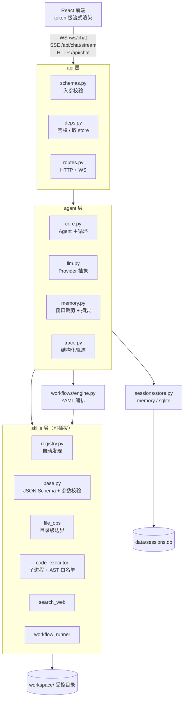
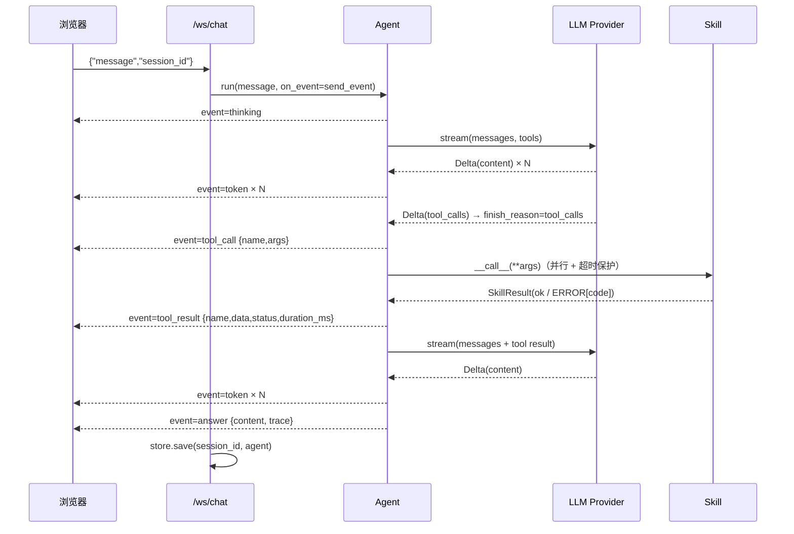

# 架构说明

> 这份文档解释「为什么这样分层」，不是「有哪些文件」。改代码前先读它，能避免把安全边界重新拆掉。

## 全景图

## 分层职责

| 层 | 文件 | 只做一件事 |
|---|---|---|
| 配置 | `config.py` | 类型化 + 边界校验的环境变量；派生属性（`use_mock`、`cors_origins`） |
| 模型接入 | `agent/llm.py` | 把「流式 + 工具调用增量」抽象成 `Delta`；重试、降级、Mock |
| 记忆 | `agent/memory.py` | 只在 user 轮边界切窗、按 token 预算裁剪、保留 `assistant(tool_calls)` ↔ `tool` 配对 |
| 主循环 | `agent/core.py` | `thinking → token* → tool_call → tool_result* → answer`；并行工具、超时、错误回喂 |
| 观测 | `agent/trace.py` | 每一步的耗时/状态/token，随 `answer` 事件返回前端 |
| 技能 | `skills/*` | 每个技能自己声明 JSON Schema，`BaseSkill.__call__` 统一校验 + 兜异常 + 计时 |
| 编排 | `workflows/engine.py` | YAML 步骤串联，模板变量解析，失败即结构化返回 |
| 会话 | `sessions/store.py` | `SessionStore` 协议 + 内存 LRU/TTL + SQLite upsert 淘汰 |
| HTTP | `api/*` | 入参校验、鉴权依赖、路由（不含业务逻辑） |
| 组装 | `main.py` | `create_app()` 工厂 + lifespan + 中间件 + 静态托管 |

## 一次请求的时序

## 三个关键设计决策

### 1. 事件流只有一个信封

WebSocket 与 SSE 发的是同一个 JSON：`{"event": "...", "data": {...}}`。
前端只写一份解析逻辑，两种传输可以互换。事件全集见 [TOOL_PROTOCOL.md](TOOL_PROTOCOL.md)。

### 2. 工具错误必须能被模型读懂

技能失败不抛异常穿透到 HTTP 层，而是转成 `SkillResult(ok=False, error_code=..., error=...)`，
再由 `as_tool_content()` 序列化成 `ERROR[path_escape]: ...` 回喂给模型。
模型看到的是「可纠错的事实」，不是「连接断了」。

### 3. 记忆裁剪以「轮」为单位，不以「条」为单位

一次工具调用会在消息里留下两条记录：带 `tool_calls` 的 assistant 消息和对应的 `tool` 消息。
从中间按条数硬切，会留下孤儿 `tool` 消息，OpenAI 兼容接口直接返回 400。
`memory.py` 因此在 user 轮边界切窗，并在 token 预算裁剪时整组丢弃。

## 安全边界（改动前必读）

| 面 | 约束 | 代码 |
|---|---|---|
| 路径 | 目录级包含判断（`commonpath`），拒绝 `workspace2/` 这类同前缀兄弟目录 | `skills/file_ops.py` |
| 代码执行 | 子进程 `python -I` + 临时工作目录 + AST 白名单 + 危险调用拦截 + 超时 kill | `skills/code_executor.py` |
| 配置 | `POST /api/config` 默认 403；开启后仍需 `ADMIN_TOKEN`（`hmac.compare_digest`） | `api/deps.py` |
| CORS | 白名单，禁止 `*` + credentials 的非法组合 | `main.py` |
| 请求体 | 超限直接 413，不进入业务逻辑 | `main.py` |
| 会话 | LRU + TTL + SQLite 淘汰，防止无限涨内存 | `sessions/store.py` |
